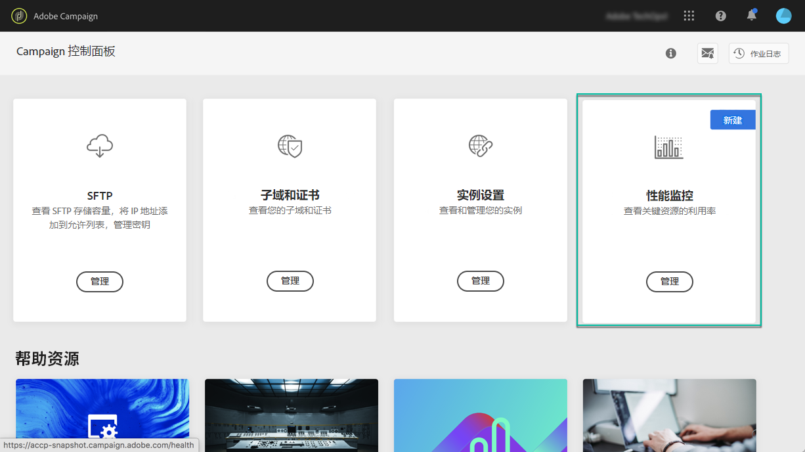

# 关于性能监控 {#about-performance-monitoring}

控制面板提供了多项功能，可帮助您监控实例并确保实现最佳性能。

使用控制面板主页中的&#x200B;**[!UICONTROL 性能监控]**&#x200B;信息卡，可监控 Campaign 实例的使用情况，如其数据库容量。 如需详细信息，请参阅[此小节](../../performance-monitoring/using/database-monitoring.md)。

>[!NOTE]
>
>在即将发布的控制面板版本中，此信息卡将提供额外的监控功能。

