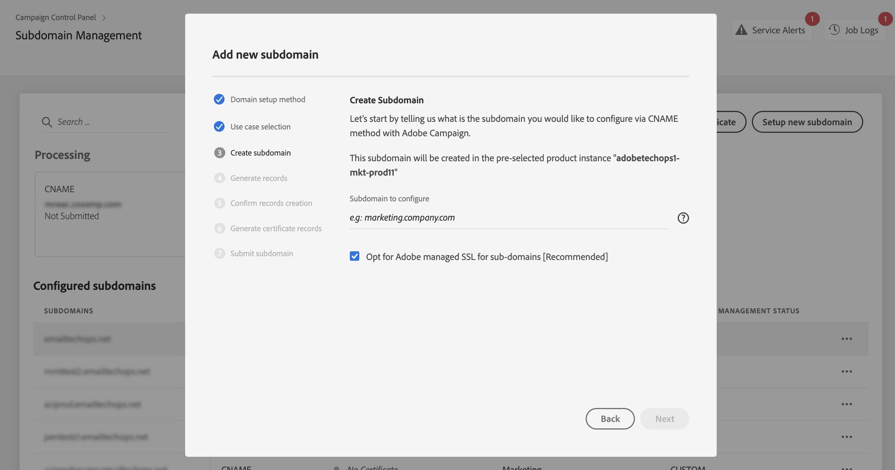
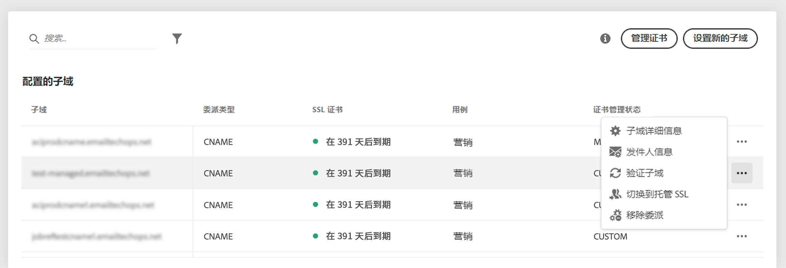
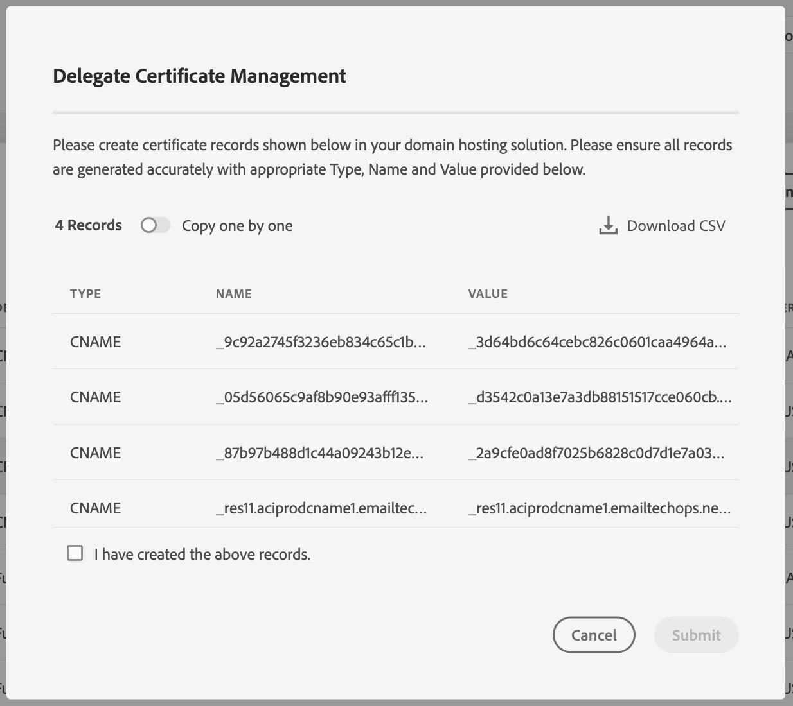

# 将子域的 SSL 证书委派给 Adobe {#delegate-ssl-certificates}

>[!CONTEXTUALHELP]
>id="cp_managed_ssl"
>title="将子域的 SSL 证书委派给 Adobe"
>abstract="通过控制面板，可让 Adobe 管理您的子域的 SSL 证书。 如果您使用 CNAME 设置您的子域，则将自动生成并提供证书记录，以便在您的域托管解决方案中生成证书。"

强烈建议将子域的 SSL 证书管理委派给 Adobe，因为 Adobe 每年都会自动创建证书并在证书过期前续订证书。

如果使用 CNAME 来设置子域委派，Adobe 将提供证书记录以将其用于域托管解决方案，从而生成证书。

可以在设置新子域或已委派子域时向 Adobe 委派 SSL 证书。

>[!NOTE]
>
>Adobe 管理的 SSL 是一项免费功能，可供用户免费使用。 将子域证书委派给 Adobe 是以透明的方式进行的，对您的营销活动和可投放性没有影响。 [了解有关 SSL 证书管理的更多信息](monitoring-ssl-certificates.md#management)

## 委派新子域的 SSL 证书 {#new}

要在设置新子域时委派 SSL 证书，请启用子域配置向导的&#x200B;**[!UICONTROL 为子域选择使用 Adobe 托管 SSL]** 选项。 证书生成过程因子域委派方法而异：

* **完全子域委派**：Adobe 将自动请求并安装 SSL 证书，无需您执行任何操作。 提交子域配置后，将立即在子域设置工作流中处理证书安装请求。 [了解有关完全子域委派的更多信息](setting-up-new-subdomain.md#full-subdomain-delegation)

* **CNAME 委派**：稍后将在配置向导中提供要复制到托管解决方案中的证书记录。 在提交子域配置之前，您需要在域托管解决方案中生成这些证书记录。 [了解有关 CNAME 委派的更多信息](setting-up-new-subdomain.md#use-cnames)

{width="70%"}

## 为已委派的子域委派 SSL 证书 {#delegated}

要为已委派的子域委派 SSL 证书，请单击所需子域旁边的省略号按钮，然后单击&#x200B;**[!UICONTROL 切换到托管 SSL]**。

{width="70%"}

证书生成过程取决于子域的原始配置方式：

### 完全委派的子域

对于使用完全子域委派（使用 Adobe 名称服务器）设置的子域，Adobe 会自动请求并安装 SSL 证书。 单击&#x200B;**[!UICONTROL 切换到托管 SSL]** 并进行确认后，将立即提交证书安装请求，无需您执行任何其他操作。

### CNAME 委派的子域

对于使用 CNAME 委派设置的子域，会显示一个对话框，其中包含 Adobe 自动生成的证书记录。 逐个复制这些记录，或者下载 CSV 文件，然后导航到域托管解决方案以生成匹配的证书。

请确保所有证书记录均已生成至您的域托管解决方案中。 如果一切配置正确，请确认创建记录，然后单击&#x200B;**[!UICONTROL 提交]**。

{width="70%"}
