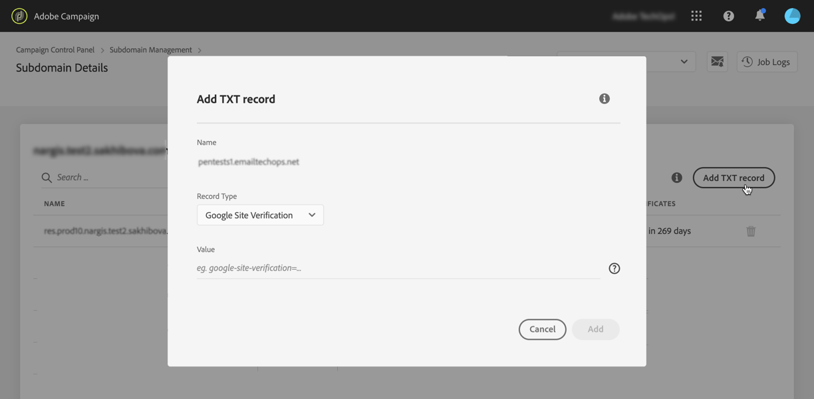
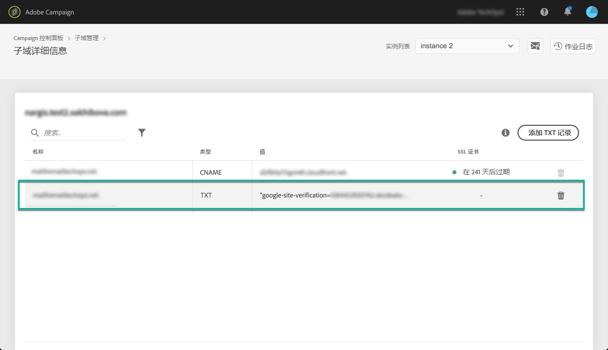

# 添加 Google 站点验证记录 {#adding-a-google-txt-record}

为了确保高收件箱率和低垃圾邮件率，一些诸如 Google 之类的服务要求您将 TXT 记录添加到域设置，以验证您是否拥有该域。

目前，Gmail 是最受欢迎的电子邮件地址提供商之一。 为了确保电子邮件的良好传递性并成功投放到 Gmail 地址，Adobe Campaign 允许您向子域添加特殊的 Google 网站验证 TXT 记录，以确保对其进行验证。

要将 Google TXT 记录添加到用于通过电子邮件发送 Gmail 地址的子域，请执行以下步骤：

1. 从子域列表中，单击所需子域旁边的省略号按钮，然后选择&#x200B;**[!UICONTROL 子域详细信息]**。

1. 单击&#x200B;**[!UICONTROL 添加 TXT 记录]**&#x200B;按钮，然后从&#x200B;**[!UICONTROL 记录类型]**&#x200B;下拉列表中选择 **[!UICONTROL Google 站点验证]**。

1. 输入在 G Suite 管理工具中生成的值。 有关详细信息，请参阅 [G Suite 管理员帮助](https://support.google.com/a/answer/183895)。

   

1. 单击&#x200B;**[!UICONTROL 添加]**&#x200B;按钮确认。

   

添加 TXT 记录后，需要通过 Google 验证该记录。 为此，请导航到 G Suite 管理员工具，然后启动验证步骤（请参阅 [G Suite 管理员帮助](https://support.google.com/a/answer/183895)）。

要删除记录，请从记录列表中选中该记录，然后单击删除按钮。

>[!NOTE]
>
>可以从 DNS 记录列表中删除的唯一记录是您之前添加的记录（在我们的示例中为 Google TXT 记录）。

在介绍如何使用 [Campaign v7/v8](https://experienceleague.adobe.com/docs/campaign-classic-learn/control-panel/subdomains-and-certificates/google-txt-record-management.html?lang=zh-Hans#subdomains-and-certificates) 或 [Campaign Standard](https://experienceleague.adobe.com/docs/campaign-standard-learn/control-panel/subdomains-and-certificates/google-txt-record-management.html?lang=zh-Hans#subdomains-and-certificates) 的视频中了解这一功能
